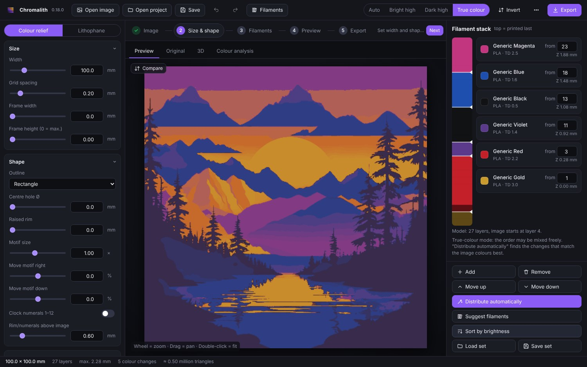
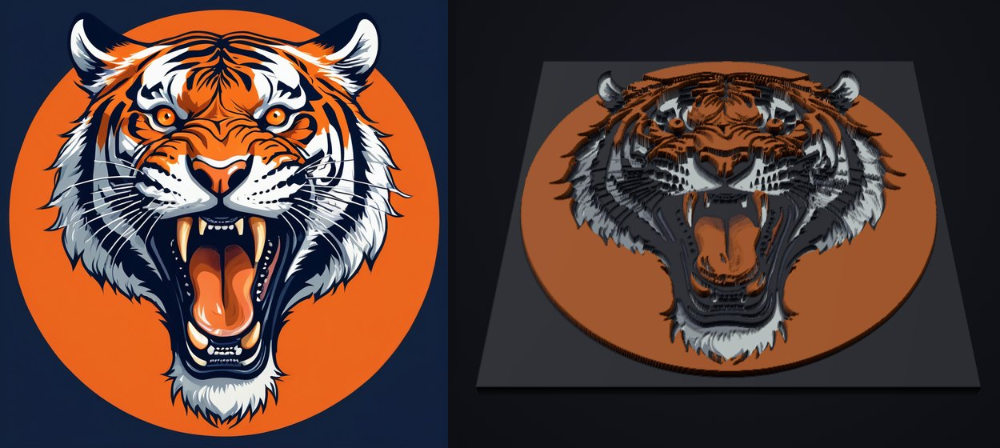
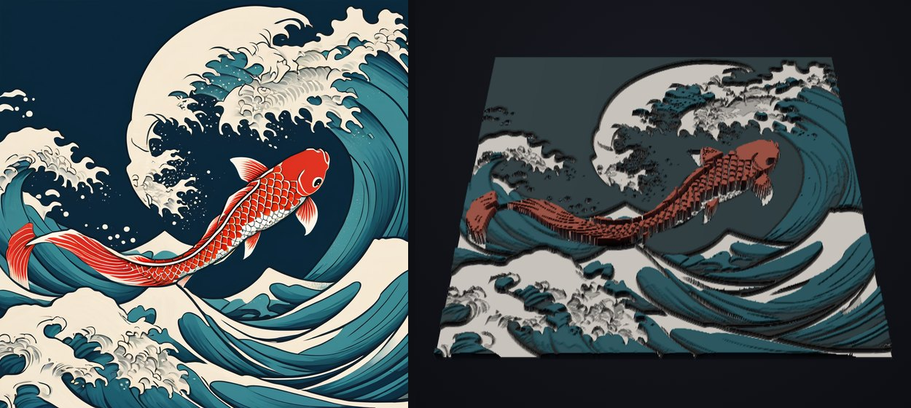
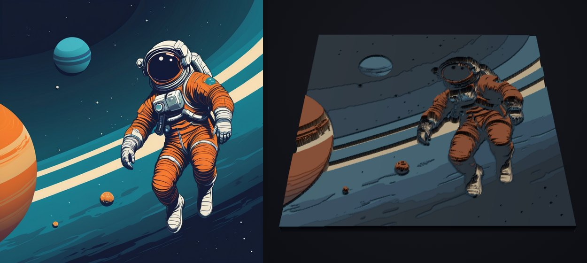
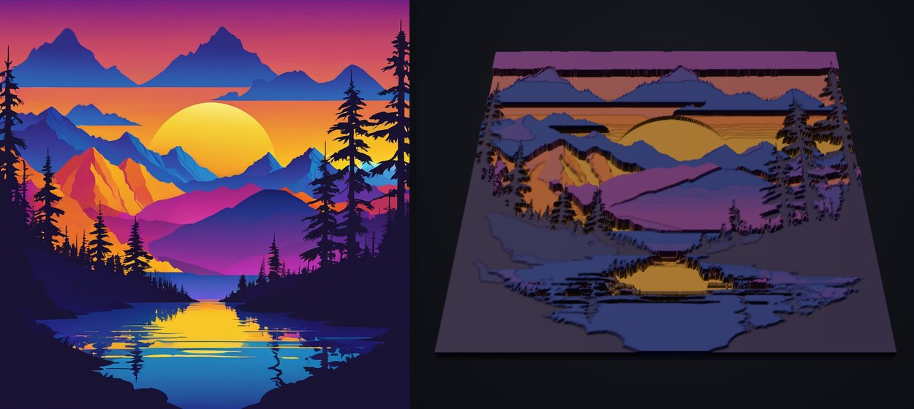
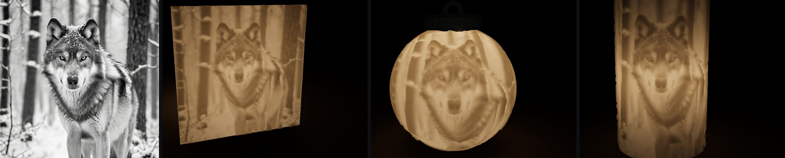

# Chromalith

**Turn a picture into a multi-colour 3D print.** Chromalith converts an image into a flat relief that is
printed layer by layer with just a few filament colours. Thin filament layers are translucent, so the
colours blend into gradients and shading while printing. Chromalith calculates the heights, previews
the colour mix, and exports the model together with a colour change plan. It also makes **lithophanes**
(flat, curved, lampshade cylinder, Christmas ornament) with a realistic backlight simulation.

Free and open source (MIT). Windows desktop app; the same code also runs in a browser.
The interface follows your system language (English or German).



## Showcase

Picture in, printable multi-colour relief out. Left: the original image. Right: the 3D model Chromalith builds
from it, coloured only by stacking a handful of filaments (here picked automatically by "Suggest filaments").






**Lithophanes** from the same tool: flat picture, sphere ornament with screw cap, and lampshade cylinder,
shown in the built-in light simulation.



<sub>All showcase images were generated for this project and are free to use.</sub>

## Download

Get the latest version from **[Releases](https://github.com/LX-S93/chromalith/releases/latest)**:

- `Chromalith-<version>-Setup.exe` – installer with a start menu entry (no admin rights needed),
- `Chromalith-windows.zip` – a single `Chromalith.exe` to run directly.

Requires the Microsoft WebView2 runtime, which is part of Windows 10/11. The installer is not code-signed,
so Windows SmartScreen may ask for confirmation on first start ("More info" → "Run anyway").

**Updates:** the installed app checks for a new release on start and offers to install it
(menu **⋯ → Check for updates …**). The download comes from this repository's releases and is verified
by size and SHA-256 before it is started.

## Features

- Image → height map with four height modes (auto, bright high, dark high, true colour)
- Filament stack with live preview of the colour blending, based on each filament's **TD**
- Automatic distribution of colour changes and **filament suggestions** from your library
- 2D preview with before/after slider, 3D view with layer slider and flat-original-vs-relief comparison
- Shapes: rectangle, circle, centre hole, raised rim, clock numerals; scale and move the motif inside the shape
- Colour islands: recolour selected areas
- Export: STL, 3MF as a ready-to-slice project for **Bambu Studio / OrcaSlicer with AMS** (filaments on slots,
  layer heights and filament changes included) or with colour changes for PrusaSlicer, colour change list
  (text and JSON), preview image and a step-by-step **print assistant** page for your phone
- The stack shows the AMS slot of every filament and warns when it needs more filaments than the AMS has slots
- Consumption, weight and cost per filament
- Filament library with import, plus optional read-only sync with [Spoolman](https://github.com/Donkie/Spoolman)
- **TD calibration:** print a step wedge, photograph it backlit and let Chromalith derive the TD, or state the
  first step that no light shines through
- **Day-and-night image:** a second image that only appears when the print is lit from behind, built as a
  single-colour back plate behind the colour relief, with a preview of both views
- **Lithophanes:** flat, curved, cylinder (lampshade) and sphere (ornament with hanging loop and optional
  screw cap for the light); place, scale and repeat the image on the body without distortion; light simulation
  with a visible lamp and different light sources; STL export

## Workflow

1. **Open image** (Ctrl+O or drop an image into the window).
2. Set **size and layers** on the left. The layer heights must later be set identically in the slicer.
3. Build the **filament stack** on the right (bottom = printed first). "Add" opens the library,
   "Distribute automatically" places the changes, "Suggest filaments" picks matching colours.
   Then fine-tune the start layers and watch the preview.
4. **Export** (Ctrl+E) writes the model, the colour change plan, a preview and the print assistant.
5. Open the `.3mf` in your slicer (see below). In other slicers load the STL and insert a colour change
   (pause / M600) at the listed layers.

Projects are saved as `.chroma` (image, settings and stack in one file).

## 3MF for your slicer and the AMS

Menu **⋯ → Slicer and AMS …** sets what the `.3mf` is written for.

**Bambu Studio / OrcaSlicer.** These slicers take filament changes and layer heights only from a complete
project with printer, process and filaments. Only your slicer knows these settings, so Chromalith needs a
project saved there once as a **template**:

1. In the slicer select your printer and a process, and add as many filaments as your AMS has slots
   (each with the material of your spools).
2. Choose *File → Save Project as*. The build plate may be empty.
3. In Chromalith choose that `.3mf` under **Slicer and AMS**. It is remembered for all projects.

Every export is then a project you only have to open and slice: printer and process from your template, the
colours of the stack on filaments 1…n in the order they are printed, first layer and layer height, 100% infill,
and a filament change at each colour change, so the AMS swaps on its own. Before printing check that the
material of each slot matches your spools. The flush volumes are an estimate based on the colours; the slicer
can recalculate them.

If the stack needs more different filaments than the template has, the file contains no filament changes and
Chromalith warns beforehand: the stack shows the slot of every filament, and "Suggest filaments" limits itself
to the number of slots. Without an AMS choose "Pause, change by hand": the printer then stops before each
change. Without a template the `.3mf` contains only the model.

**PrusaSlicer.** The colour changes (M600) are in the file; set first layer, layer height and 100% infill in
the print profile.

## Filaments and TD

Each filament has a colour and a **TD** (transmission distance, in mm): the thickness at which it lets
practically no light through. Small TD = covers quickly (e.g. black), large TD = stays translucent
(e.g. white, yellow).

- A small starter library with **rough estimates** is included. For good results enter the TD of your own filaments.
- **⋯ → Filament library → Import** reads Chromalith files as well as library and set files in the common
  JSON schema (`Brand / Name / Type / Color / Transmissivity`).
- **⋯ → Measure TD …** determines the TD of your own filament (see below).

### Measuring the TD

1. **Print the step wedge.** "Save step wedge …" writes a small strip (10 steps of 8 × 20 mm by default) as STL
   and 3MF. The thinnest step is one first layer thick, every further step adds the chosen number of layers.
   Print it in the filament you want to measure with 100% infill and exactly these layer heights. For
   translucent filaments (white, yellow, transparent) use more layers per step.
2. **Backlit photo.** Put the wedge on an evenly bright surface (a white image on a tablet or phone works well),
   darken the room and take a photo straight from above, without flash and preferably without HDR. Load the photo
   and drag the two markers to the centre of the thinnest and of the thickest step. Chromalith measures the
   brightness of every step and fits the model `brightness ∝ exp(−ln(20)·t/TD)` to it. Lamp brightness and
   exposure cancel out; overexposed steps and steps that no light passes through are left out automatically.
3. **Or by hand.** Hold the wedge in front of a light and choose the first step that no light shines through.
   The TD is taken as the thickness between this step and the one before.

The result is a good guide, not a lab measurement: cameras and lights are never perfectly neutral. The photo
is more precise than the estimate by eye, because it evaluates the whole curve.

Preview colour model: layers are stacked bottom to top; a layer of thickness *t* covers
`1 − exp(−ln(20)·t/TD)` (95 % at *t* = TD). This is an approximation – real prints differ depending on
light and filament.

## Day-and-night image

In daylight you see the colour relief; with a light behind it a second, hidden image appears. Chromalith builds
this from **two parts**: the colour relief as usual and a single-colour **back plate** whose thickness carries
the night image (thin = bright, like a lithophane).

1. Build the colour relief as usual, then open **Day-and-night image** on the left and choose the night image.
   It fills the area of the day image; whatever sticks out is cropped around the centre.
2. Switch the preview between **Day** and **Night**. The night view shows both plates lit from behind, with the
   exposure adjusted to the brightest point as a camera would do.
3. **Export** additionally writes `<name>_night_image.stl` and a backlit preview. Print the back plate in one
   colour with 100% infill, smooth side on the bed. Then turn it over and put its smooth side behind the colour
   relief, for example in a light frame. The STL is already mirrored for this, and a small raised dot marks the
   corner that belongs at the top left when you look at the picture from the front.

The colour relief itself lets more light through where it is thin. The back plate **compensates** for this
(thicker where the relief is brighter), so that the night image appears and not a shadow of the day image. With
"Automatic thickness" the plate becomes just thick enough for this compensation plus a strong contrast of the
night image, up to 6 mm. If that is not enough with the chosen filament, Chromalith names the TD that would be
and picks a matching light, neutral filament from the library the first time.

What to expect, honestly:

- Only brightness is compensated. Coloured areas of the day image still tint the light, so the day image stays
  visible as a faint colour pattern.
- It works best with a stack that **starts with the darkest filament at the bottom**: the relief then lets a
  similar, small amount of light through everywhere. If translucent layers lie below an opaque one, some places
  let through many times more light than others; fine lines and edges of the day image then show through, and
  Chromalith warns about it.
- Little light arrives at the front (often around 1%), so the night image needs a strong, even light such as an
  LED panel and a dark room.
- The preview is a simulation based on the TD values of your filaments. Measured TD values make it more reliable.

## Support

Chromalith is free. If it is useful to you and you would like to say thanks:

[](https://buymeacoffee.com/lxs93)

Bug reports and ideas are welcome as [issues](https://github.com/LX-S93/chromalith/issues).

## For developers

Requirements: Node.js 22, plus Rust (rustup) for the desktop app.

```
cd app
npm install
npm run dev          # UI in the browser: http://localhost:1420
npm test             # tests of the core (vitest)
npm run build        # static web version in app/dist/
npx tauri dev        # desktop app in development mode
npx tauri build      # Windows installer + exe
```

Layout:

- `app/src/core/` – core without UI (TypeScript, no dependencies): height map, mesh/STL, 3MF, filaments,
  colour change plan and simulation, colour matching, lithophanes, `.chroma` projects
- `app/src/worker.ts` – computes in the background so the UI stays responsive
- `app/src/ui/`, `app/src/main.ts` – user interface; `app/src/platform.ts` – files (desktop/browser)
- `app/src/i18n.ts`, `app/src/i18n-en.ts` – the UI source strings are German; English is translated at display time
- `app/src/update.ts`, `app/src-tauri/` – updater and desktop shell (Rust/Tauri)
- `python/` – the earlier Python/Qt version (up to 0.2.0), reference only

Releases: bump the version in `app/package.json`, `app/src-tauri/tauri.conf.json` and
`app/src-tauri/Cargo.toml`, add a `CHANGELOG.md` entry and push to `main`; GitHub Actions builds and
publishes the release.

## License

[MIT](LICENSE) © LX-S93. Chromalith is an independent development.
