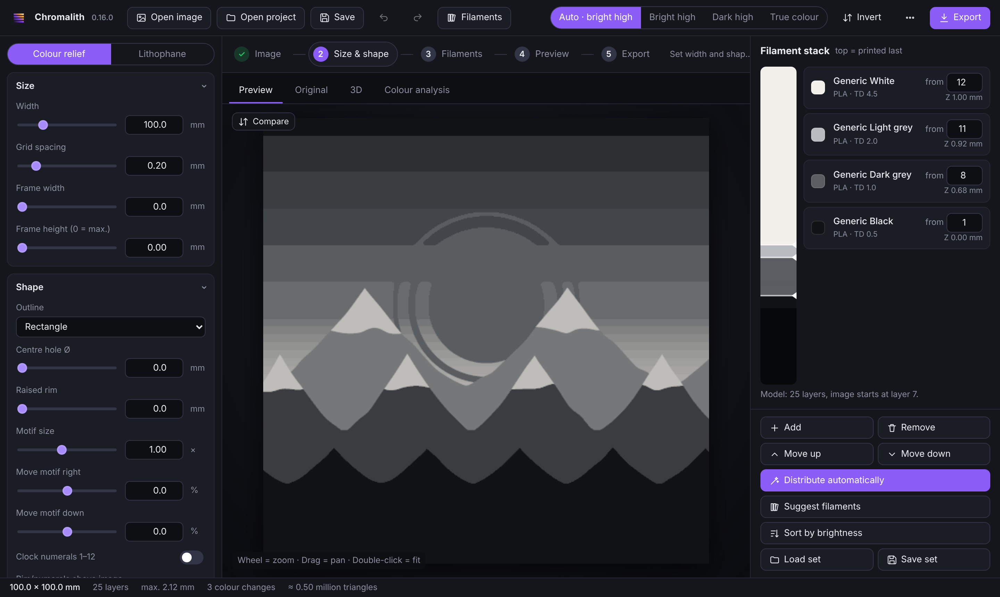
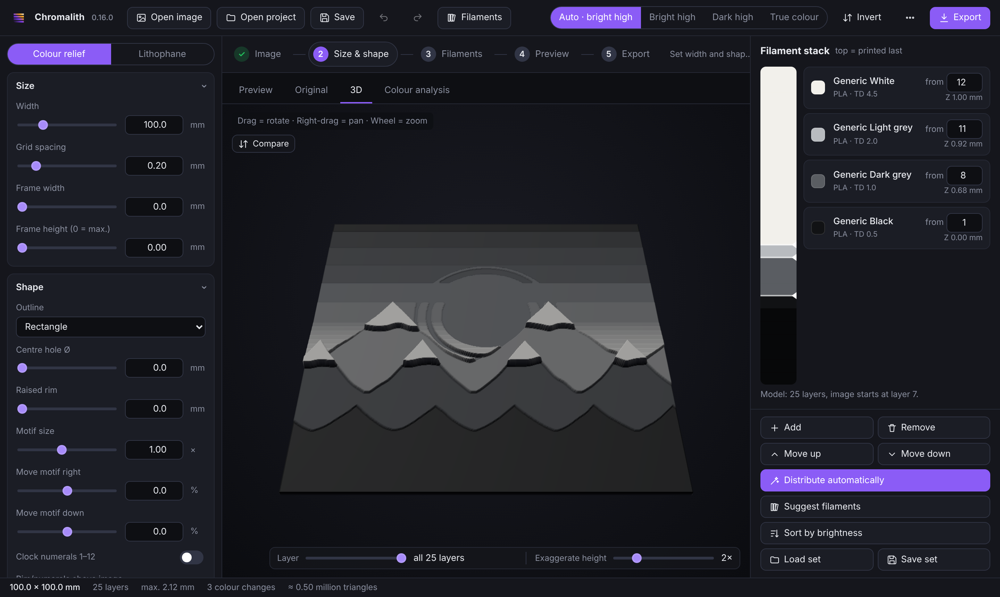
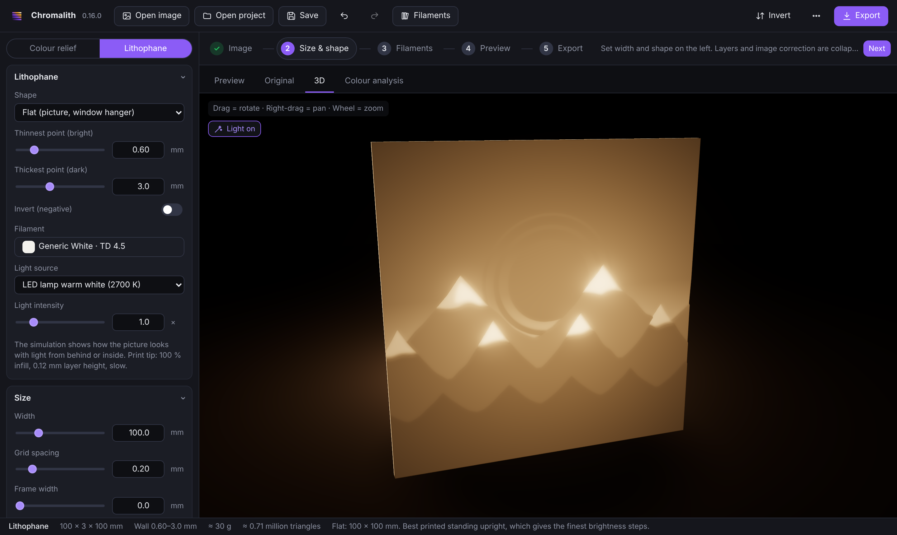

# Chromalith

**Turn a picture into a multi-colour 3D print.** Chromalith converts an image into a flat relief that is
printed layer by layer with just a few filament colours. Thin filament layers are translucent, so the
colours blend into gradients and shading while printing. Chromalith calculates the heights, previews
the colour mix, and exports the model together with a colour change plan. It also makes **lithophanes**
(flat, curved, lampshade cylinder, Christmas ornament) with a realistic backlight simulation.

Free and open source (MIT). Windows desktop app; the same code also runs in a browser.
The interface follows your system language (English or German).



| 3D view | Lithophane with light simulation |
| --- | --- |
|  |  |

## Download

Get the latest version from **[Releases](https://github.com/LX-S93/chromalith/releases/latest)**:

- `Chromalith-<version>-Setup.exe` – installer with a start menu entry (no admin rights needed),
- `Chromalith-windows.zip` – a single `Chromalith.exe` to run directly.

Requires the Microsoft WebView2 runtime, which is part of Windows 10/11. The installer is not code-signed,
so Windows SmartScreen may ask for confirmation on first start ("More info" → "Run anyway").

**Updates:** the installed app checks for a new release on start and offers to install it
(menu **⋯ → Check for updates …**). The download comes from this repository's releases and is verified
by size and SHA-256 before it is started.

## Features

- Image → height map with four height modes (auto, bright high, dark high, true colour)
- Filament stack with live preview of the colour blending, based on each filament's **TD**
- Automatic distribution of colour changes and **filament suggestions** from your library
- 2D preview with before/after slider, 3D view with layer slider and flat-original-vs-relief comparison
- Shapes: rectangle, circle, centre hole, raised rim, clock numerals; scale and move the motif inside the shape
- Colour islands: recolour selected areas
- Export: STL, 3MF with embedded colour changes (Bambu Studio / OrcaSlicer), colour change list (text and JSON),
  preview image and a step-by-step **print assistant** page for your phone
- Consumption, weight and cost per filament
- Filament library with import, plus optional read-only sync with [Spoolman](https://github.com/Donkie/Spoolman)
- **Lithophanes:** flat, curved, cylinder (lampshade) and sphere (ornament with hanging loop), light simulation
  with different lamps, STL export

## Workflow

1. **Open image** (Ctrl+O or drop an image into the window).
2. Set **size and layers** on the left. The layer heights must later be set identically in the slicer.
3. Build the **filament stack** on the right (bottom = printed first). "Add" opens the library,
   "Distribute automatically" places the changes, "Suggest filaments" picks matching colours.
   Then fine-tune the start layers and watch the preview.
4. **Export** (Ctrl+E) writes the model, the colour change plan, a preview and the print assistant.
5. In Bambu Studio / OrcaSlicer open the `.3mf`: the colour changes are already in the layer slider.
   In other slicers load the STL and insert a colour change (pause / M600) at the listed layers.

Projects are saved as `.chroma` (image, settings and stack in one file).

## Filaments and TD

Each filament has a colour and a **TD** (transmission distance, in mm): the thickness at which it lets
practically no light through. Small TD = covers quickly (e.g. black), large TD = stays translucent
(e.g. white, yellow).

- A small starter library with **rough estimates** is included. For good results enter the TD of your own filaments.
- **⋯ → Filament library → Import** reads Chromalith files as well as library and set files in the common
  JSON schema (`Brand / Name / Type / Color / Transmissivity`).

Preview colour model: layers are stacked bottom to top; a layer of thickness *t* covers
`1 − exp(−ln(20)·t/TD)` (95 % at *t* = TD). This is an approximation – real prints differ depending on
light and filament.

## Support

Chromalith is free. If it is useful to you and you would like to say thanks:

[](https://buymeacoffee.com/lxs93)

Bug reports and ideas are welcome as [issues](https://github.com/LX-S93/chromalith/issues).

## For developers

Requirements: Node.js 22, plus Rust (rustup) for the desktop app.

```
cd app
npm install
npm run dev          # UI in the browser: http://localhost:1420
npm test             # tests of the core (vitest)
npm run build        # static web version in app/dist/
npx tauri dev        # desktop app in development mode
npx tauri build      # Windows installer + exe
```

Layout:

- `app/src/core/` – core without UI (TypeScript, no dependencies): height map, mesh/STL, 3MF, filaments,
  colour change plan and simulation, colour matching, lithophanes, `.chroma` projects
- `app/src/worker.ts` – computes in the background so the UI stays responsive
- `app/src/ui/`, `app/src/main.ts` – user interface; `app/src/platform.ts` – files (desktop/browser)
- `app/src/i18n.ts`, `app/src/i18n-en.ts` – the UI source strings are German; English is translated at display time
- `app/src/update.ts`, `app/src-tauri/` – updater and desktop shell (Rust/Tauri)
- `python/` – the earlier Python/Qt version (up to 0.2.0), reference only

Releases: bump the version in `app/package.json`, `app/src-tauri/tauri.conf.json` and
`app/src-tauri/Cargo.toml`, add a `CHANGELOG.md` entry and push to `main`; GitHub Actions builds and
publishes the release.

## License

[MIT](LICENSE) © LX-S93. Chromalith is an independent development.
